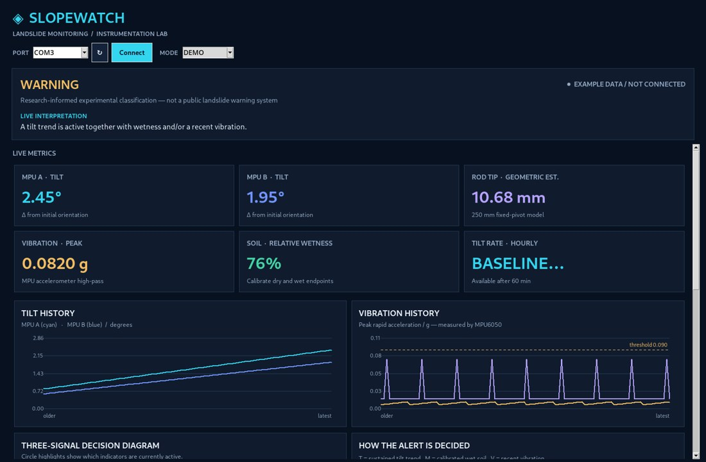

# SlopeWatch — Landslide Detection and Multi-Depth Soil Monitoring

A low-cost prototype for monitoring ground tilt/movement and soil moisture using an STM32F411CE Black Pill, dual MPU6050 IMUs, and a capacitive soil-moisture sensor. The project materials also document a proposed vibration-alert and wireless monitoring architecture.

> **Project status:** academic prototype / engineering review. This repository is not a certified landslide warning product and must not be used as the sole basis for evacuation or public-safety decisions.

## Prototype photos

The photos below show the physical pipe/enclosure assembly and exposed sensor wiring during laboratory prototyping.

  
  

## Dashboard UI

The dashboard screenshot below is a **sample preview using example data**; it is not a live connected monitoring session.

  

[View the dashboard decision-logic panel](docs/assets/dashboard_logic_preview.jpg)

## Repository contents

- `firmware/` — PlatformIO firmware project for STM32F411CE.
- `desktop/` — Python dashboard/visualization source and requirements.
- `hardware/` — user-supplied circuit diagram and prototype photographs.
- `cad/` — 3D-printable enclosure STL files.
- `docs/` — technical review, original project presentation, and evidence images.

## Key hardware described in the project

- STM32F411CE Black Pill
- 2 × MPU6050 6-axis IMUs
- Capacitive soil-moisture sensor
- PVC probe / enclosure structure
- The supplied circuit diagram also depicts an Omron D7S seismic/vibration sensor and an active buzzer module.

The technical review distinguishes components/features shown in the presentation or circuit illustration from features actually evidenced in the supplied firmware. In particular, verify sensor pin assignments, D7S integration, buzzer driver implementation, and power requirements before assembling the depicted circuit.

## Start here

1. Read [the technical review (PDF)](docs/SlopeWatch_TECHNICAL_REVIEW.pdf).
2. View the [user-supplied final circuit diagram](hardware/CIRCUIT_DIAGRAM.png).
3. Review [the firmware](firmware/firmware/src/main.cpp) and [PlatformIO configuration](firmware/firmware/platformio.ini).
4. Review the [desktop dashboard](desktop/dashboard.py).
5. Inspect [the enclosure CAD files](cad/).

## Build notes

### Firmware

Open `firmware/firmware` in PlatformIO and inspect `platformio.ini` for the target environment and dependencies before building or flashing. Confirm the board variant, serial settings, actual pin map, I²C bus wiring, sensor addresses, and voltage levels against the assembled hardware.

### Desktop dashboard

Install dependencies from `desktop/requirements.txt`, then run the dashboard from the `desktop` directory using Python. Confirm the expected serial port and baud rate in the source before connecting the microcontroller.

## Engineering cautions and validation gaps

- MPU6050 readings require calibration and drift management.
- Tilt-derived displacement is an estimate that depends on geometry and reference assumptions; it is not direct soil displacement measurement.
- Moisture thresholds require calibration for the actual probe, soil type, and installation.
- Vibration, buzzer, and radio behaviour must be validated on the physical hardware.
- The final circuit image is retained as supplied; its pin labels and connections should be checked against the source code and actual board before power-up.
- The STL files do not encode physical units. Confirm intended units, dimensions, fit, sealing, and print tolerances.
- Perform controlled tests and independent validation before considering any field deployment.

## License

No license has been added. All rights remain with their respective authors until a license is selected.
