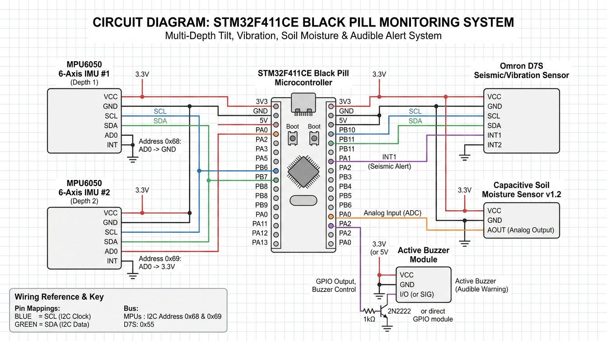
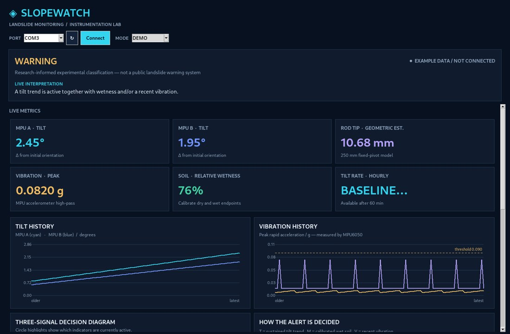

# SlopeWatch - Landslide Detector
## Technical Review and Integration Audit

**Project:** EE3030A, IIT Palakkad (2026)  
**Evidence reviewed:** presentation PDF, firmware and desktop dashboard source ZIP, two STL exports, and two prototype photographs  
**Review date:** 23 November 2026  
**Review basis:** uploaded artifacts only; no unprovided hardware, source branches, or test logs were assumed.

> **Engineering status:** Laboratory prototype / proof-of-concept. The supplied files do not demonstrate a calibrated, field-validated landslide warning instrument. Do not use the prototype's labels or thresholds for evacuation, public warning, or safety decisions.

## 1. Executive summary

The submitted material describes a low-cost slope-monitoring concept based on an STM32F411CE Black Pill, two MPU6050 inertial sensors at different depths, an analog soil-moisture sensor, vibration sensing, and a warning/dashboard layer. The supplied code archive contains a concrete implementation of the STM32 serial telemetry firmware and a Python/Tkinter desktop dashboard. The two STL files provide a small enclosure base and a lid. The photographs show a PVC-pipe assembly and an exposed sensor/wiring arrangement on a laboratory bench.

The strongest implemented portion in the supplied repository is the **dual-MPU6050 + analog moisture + serial dashboard prototype**. The dashboard source parses JSON telemetry, plots tilt and MPU-derived acceleration residuals, presents prototype status categories, supports dry/wet moisture calibration commands, and exports captured telemetry as CSV. The firmware configures two MPU6050 addresses on one I2C bus, samples them nominally at 40 Hz, samples moisture at 1 Hz, sends a JSON line every 500 ms, and includes Demo and Research-inspired modes.

However, several features described in the presentation are not present in the supplied code snapshot: Omron D7S or SW-420 sensor acquisition, buzzer/siren control, LoRa radio, and a 3D HTML dashboard. The supplied desktop dashboard is a 2D Python desktop application. The slide deck includes a terminal screenshot that reports a D7S reading and gyro values, suggesting that the presentation may include a different or earlier firmware build than the ZIP. No corresponding source or raw log is included to reproduce that result.

The most important engineering issue is the **mechanical measurement principle**. The code's displacement output is `250 mm * sin(tilt_change)` and is explicitly based on a hypothetical fixed pivot. It calculates separate geometric values for each MPU but does not calculate a measured relative displacement between soil layers. If both MPU6050 boards are rigidly attached to the same straight pipe, they largely share the same orientation; two sensors on one rigid member do not, by themselves, prove independent movement of two soil layers. The final mechanical arrangement needs separate reference/anchoring behavior and ground-truth validation before interpreting tilt as soil displacement.

### Main findings

1. **Implementation is narrower than the slide-deck architecture.** Current firmware reads two MPU6050 devices and an analog moisture input. It derives a vibration indicator from MPU accelerometer data. It does not read the Omron D7S or SW-420.
2. **No alarm output is implemented in the supplied firmware.** PC13 is toggled as a 500 ms heartbeat LED; it is not driven by alert status, and there is no buzzer GPIO, siren state machine, or LoRa driver in the source.
3. **The displacement value is a model estimate, not measured ground displacement.** The pivot, gauge length, and mechanical reference are assumptions; the code applies the same 250 mm length to both sensors.
4. **The depth spacing is inconsistent.** The slide deck shows a 150 mm gauge length / 15 cm sensor spacing in places and 25 cm in another slide; the firmware assumes 250 mm.
5. **The wiring description is inconsistent.** The code and README use one shared I2C bus (PB6/PB7) with addresses 0x68 and 0x69, while one timeline entry says two independent I2C buses.
6. **The current physical evidence does not prove environmental readiness.** The photos show exposed wiring and a bench/office setting; no sealed gland, ingress-protection test, installed slope, or controlled ground-motion test is documented.
7. **No field validation is demonstrated.** The deck lists thresholds and a single terminal-style output image, but there are no raw time-series files, reference displacement measurements, repeatability results, or false-alarm/missed-detection statistics in the uploaded set.

## 2. Evidence inventory and review method

| Supplied artifact | What was reviewed | Evidence it can support |
|---|---|---|
| `Final Presentation.pptx(1).pdf` (23 pages) | All pages; close review of circuit, layout, thresholds, prototype image, and milestones | Project intent, design claims, team roles, planned/claimed testing, and the presentation's own limitations |
| `SlopeWatch_Landslide_Dashboard_Git(1).zip` | README, `firmware/src/main.cpp`, `firmware/platformio.ini`, `desktop/dashboard.py`, requirements, and preview PNGs | Exact behavior and dependencies of the supplied code snapshot |
| `Base(1).stl` | Binary STL mesh statistics and topology | Enclosure-base envelope and mesh integrity |
| `Top(1).stl` | Binary STL mesh statistics and topology | Lid/cover envelope and mesh integrity |
| Photo `13.53.34` | Full image inspection | Visible enclosure, pipe, wiring, PCB and bench assembly state |
| Photo `13.54.07` | Full image inspection | Visible cap/pipe, cable bundle, and USB-side connection arrangement |

The STL files were loaded as triangle meshes and inspected after vertex welding. The firmware was reviewed statically. The Python dashboard passed a Python syntax compilation check. A live serial test was not performed; the environment did not contain `pyserial` or PlatformIO, and no connected hardware was available. No C++ firmware build result is claimed.

## 3. Project intent and team context

The presentation identifies the project as **Landslide Detector**, course **EE3030A**, IIT Palakkad, 2026, under Prof. Sreenath Vijaykumar. Its stated problem is the lack of affordable, continuous monitoring that can combine ground movement, rainfall/moisture-related conditions, and vibration indicators. The stated objectives are multi-sensor monitoring, shear-movement detection at different depths, and a warning framework.

The team table in presentation page 2 lists:

| Member | Roll number | Contribution stated in the presentation |
|---|---:|---|
| Sabarish R | 122401030 | Sensor selection, MPU calibration and testing |
| Bavitej E | 122401016 | Codebase optimisation; setup and exostructure design |
| Srinivas B | 122401007 | Literature selection; prototype making and testing |
| Viditha B | 122401009 | Sensor layout and upcoming testing |
| Abhinand MK | 122401002 | Research, individual sensor testing and wiring |
| Vivek K | 122401021 | Literature review on multi-MPU system |

The project framing is coherent: detect small changes, combine indicators, and communicate a local warning. The review below focuses on whether the uploaded implementation and evidence support each part of that framing.

## 4. Architecture: presented design versus supplied implementation

| Subsystem | Presentation | Supplied ZIP | Review conclusion |
|---|---|---|---|
| Processing | STM32 Black Pill / STM32F411CE | PlatformIO environment `blackpill_f411ce`; firmware is written for Arduino STM32 | Present in code configuration; physical board operation not independently verified |
| Tilt / motion | Two MPU6050 sensors at different depths | Two MPU6050 devices at 0x68 and 0x69 on one `Wire` bus | Present in firmware; physical depth anchoring still needs validation |
| Soil moisture | Analog moisture sensor, shown as v1.2 in layout | Analog input PA0, 12-bit ADC, local dry/wet calibration | Present in firmware |
| Vibration | User-supplied final circuit shows Omron D7S; presentation also shows SW-420 | High-pass acceleration residual calculated from MPU6050 accelerometers | D7S/SW-420 hardware is in the submitted schematic/presentation but neither peripheral has a driver in this code snapshot |
| Local alert | User-supplied final circuit shows an active buzzer module with a 2N2222/1 kΩ driver stage | PC13 LED heartbeat toggling every 500 ms; no buzzer output logic | Schematic design only; not implemented in supplied firmware |
| Long-range communication | LoRa SX127x is shown as a future improvement | No LoRa/SPI driver or packet format in the supplied source | Proposed, not implemented in this ZIP |
| User interface | Timeline says 3D live HTML dashboard | Python/Tkinter desktop dashboard with 2D charts and a three-signal logic diagram | Desktop UI exists; no HTML/3D implementation is included |
| Data logging | Live data / monitoring concept | Captured in memory and manually exported to CSV from the desktop app | Basic session export exists; no onboard non-volatile or cloud logging is included |

### 4.1 Firmware pinout and communication

The README and firmware agree on these key connections:

| Signal | Supplied code / README assignment |
|---|---|
| I2C SCL | PB6 |
| I2C SDA | PB7 |
| MPU A AD0 | PA9 set LOW, address 0x68 |
| MPU B AD0 | PA10 set HIGH, address 0x69 |
| Soil moisture AOUT | PA0 (analog input) |
| Soil moisture VCC / GND | 3.3 V / common GND |
| Serial | USB CDC, 115200 baud |

The firmware uses one `Wire` object and configures a 50 kHz I2C clock. It does not create two independent I2C buses. The newly supplied schematic also depicts shared I2C wiring for the MPU devices and D7S, but its STM32 pin labels and several signal routes are ambiguous (including duplicate PB11/PA2 labels). The firmware pin map remains PB6/PB7 for MPU I2C, PA9/PA10 for MPU AD0, and PA0 for moisture AOUT. The schematic should be treated as a design draft until the exact Black Pill pinout and firmware assignments are reconciled.

The revised circuit illustration below is the user-supplied final schematic for review. It expands the presentation drawing to include the Omron D7S, capacitive moisture sensor and active buzzer stage. It is included as the design submitted for review, not as evidence that each peripheral is already supported by the supplied firmware. Confirm every MCU pin label against the exact Black Pill board revision and the source before powering the circuit. In particular, the drawing contains repeated/ambiguous STM32 pin labels and some assignments differ from the supplied firmware; these are recorded in the consistency table. Verify the 3.3 V rail, all module supply limits, and that no 5 V analog signal reaches an STM32 ADC input.

**Components shown in this submitted schematic:** STM32F411CE Black Pill (1); MPU6050 6-axis IMU modules (2); Omron D7S seismic/vibration sensor (1); capacitive soil-moisture sensor v1.2 (1); active buzzer module (1); 2N2222 NPN transistor (1); 1 kΩ base resistor (1); regulated 3.3 V supply/common ground; wiring/connectors. The Omron D7S and buzzer are shown in this schematic but are not implemented by the supplied firmware snapshot.

## 5. Firmware review

### 5.1 Sampling and telemetry

The firmware constants and loop implement the following nominal schedule:

| Signal / activity | Configured interval | Nominal rate |
|---|---:|---:|
| Each MPU6050 read | 25 ms | 40 Hz |
| Soil ADC sample (16-read average) | 1000 ms | 1 Hz |
| JSON serial telemetry | 500 ms | 2 Hz |
| MPU retry after fault | 2000 ms | Retry interval |
| Research history snapshot | 60000 ms | 1 sample/minute |
| Research history capacity | 61 samples | 60-minute end-to-end span |

Telemetry is a JSON object per line at 115200 baud. Debug output is prefixed with `#`. The desktop reader ignores the debug lines and parses JSON objects. This is a sensible lightweight serial contract for a lab prototype.

### 5.2 MPU orientation and calibration

Each MPU is initialized for the +/-2 g accelerometer and +/-250 degrees/second gyro ranges. Calibration takes 80 samples with 10 ms delays and uses the average accelerometer vector as a reference direction. The firmware calculates roll and pitch from accelerometer values and calculates a tilt-change angle from the current acceleration vector relative to the reference vector.

**Important limitation:** raw gyro values are read and gyro bias values are calculated, but the supplied `calculateTilt()` routine does not use gyroscope integration or a complementary/Mahony/Madgwick fusion filter. As supplied, the tilt estimate is accelerometer-based. During dynamic movement, translational acceleration can be mistaken for a change in gravity direction. The presentation's description of using acceleration and angular velocity should not be read as proof of a fused six-axis attitude estimate in this ZIP.

### 5.3 Vibration indicator

`calculateVibration()` tracks a low-pass estimate of gravity (`GRAVITY_ALPHA = 0.08`) and calculates the magnitude of the residual acceleration. A residual of at least 0.09 g updates a global recent-vibration timer held for 3 seconds. The value is derived from the MPU6050 accelerometers. It is not a D7S seismic-intensity measurement and it is not an SW-420 digital vibration input.

### 5.4 Soil-moisture calibration

The firmware takes 16 ADC readings per update and averages them. The desktop app sends `CAL_DRY` and `CAL_WET` commands to capture endpoints. A relative wetness percentage is calculated only when the two raw endpoints are at least 100 ADC counts apart. Wetness is flagged at 70% relative wetness. This is a locally calibrated index, not volumetric water content (VWC), and the threshold is explicitly described in the README as a lab-only adjustable value.

### 5.5 Status and threshold logic

**Demo mode** uses a tilt magnitude of at least 1.0 degrees for a 3-second warning condition and 3.0 degrees for a 3-second high condition. **Research-inspired mode** waits for a full 60-minute reference and then compares the absolute change in filtered tilt magnitude over that one-hour window against 0.03 degrees/hour and 0.10 degrees/hour. Moisture at or above 70% and recent MPU-derived vibration support the rule combination.

The status priority in `statusText()` is: sensor fault; research baseline collection; high alert; warning (tilt plus wetness or recent vibration); caution (tilt alone or wetness plus vibration); disturbance; wet condition; partial data; normal. These are software labels only. The repo README correctly cautions that neither mode contains field-validated landslide probability thresholds.

### 5.6 Displacement estimate

The code calculates `dA` and `dB` as:

`d = 250 mm * sin(tilt_change)`

This is a geometric lever-arm approximation that assumes a fixed pivot and a 250 mm effective length. It does not use a measured anchor-to-sensor distance per sensor, determine the actual pivot, account for pipe bending, or derive differential displacement between two soil layers. Both sensors are given the same 250 mm length. The desktop dashboard displays the larger of the two estimates as the rod-tip estimate.

Use the label **geometric tilt estimate (fixed-pivot model)** rather than “measured soil movement.” Validate the model with a calibrated translation/tilt fixture and independent displacement reference before presenting millimetres as measured ground motion.

## 6. Desktop dashboard review

The supplied `desktop/dashboard.py` is a Python 3.10+ Tkinter application using `pyserial`. It supports port selection, connect/disconnect, Demo/Research selection, live tilt and vibration charts, soil wetness display, status text, a three-indicator logic diagram, read/error counts, dry/wet calibration commands, and CSV export.

The preview PNGs are marked as example data / not connected. They demonstrate the UI layout but are not evidence of a live or statistically valid field trial. The dashboard is not a browser-based HTML application and does not render a live 3D slope or sensor model in the supplied source.

**Code checks:** Python syntax compilation passed. There are no automated test files in the archive. A live run was not possible in this review environment because `pyserial`, PlatformIO, and connected hardware were not available. The current code's `format_num()` treats -1 as an invalid sentinel; unavailable roll/pitch values are sent as -999, so the details panel may display -999 degrees when a sensor is offline. The sentinel handling should be unified.

## 7. CAD / STL review

The presentation's page 13 also shows the enclosure concept. The image above is a render of the two supplied STL meshes themselves. Both exports contain binary STL triangle meshes. STL does not encode physical units; dimensions below are reported in STL units and interpreted as millimetres only as a project-context assumption.

| File | Vertices after welding | Triangles | Bounding dimensions (X x Y x Z) | Watertight after welding | Connected shells |
|---|---:|---:|---|---|---:|
| `Base.stl` | 64 | 140 | 60 x 50 x 29.1 | Yes | 1 |
| `Top.stl` | 40 | 76 | 60 x 50 x 3 | Yes | 1 |

The base mesh is a single connected, closed shell with consistent triangle winding after vertex welding. The top mesh is also a single connected, closed shell. This is a positive mesh-integrity result for downstream slicing. It is not a printability certification: no slicer preview, wall-thickness analysis, material selection, print orientation, support check, or physical fit test was supplied.

The two parts have the same 60 x 50 STL-unit XY envelope. The base spans Z = -9.1 to 20 and the top spans Z = 48 to 51 in their individual files. Their different Z placement suggests the files may have been exported from separate positions in an exploded CAD arrangement; the coordinates alone must not be treated as the assembled gap. The exact-fit tolerance, lid engagement, fasteners, sealing lip, and cable-gland arrangement cannot be confirmed from the two meshes alone.

**Mechanical recommendations:** state units explicitly in the CAD/export notes; export an assembled STEP (or equivalent) alongside the STLs; dimension the lid engagement and specify clearance for the intended print process; measure minimum wall thickness; add strain relief and a sealed cable entry; and print-fit the base and lid before final sensor installation.

## 8. Physical prototype photo review

### Photo A - open top and wiring (file timestamp 23 November 2026, 13:53:34)

The image shows a white PVC pipe held vertically, a rectangular top enclosure with multiple coloured wires/components exposed, and a small circuit board hanging alongside the pipe. A cable and a small instrument/interface are visible on the stool below. The photo supports the existence of a physical pipe-and-electronics prototype. It does not show a sealed enclosure, buried installation, or a controlled soil-shear test.

### Photo B - cap, pipe and cable bundle (file timestamp 23 November 2026, 13:54:07)

The second image shows a rectangular cap/enclosure mounted at the top of the white pipe and a bundle of wires leading to a small blue USB-side interface. The arrangement appears to be a bench connection. No sealed cable gland, strain relief, waterproofing, environmental enclosure rating, or installed slope is visible in the photograph.

Taken together, the photos document physical assembly progress but are not sufficient to claim outdoor/monsoon readiness.

The timeline slide (page 22) lists final insertion of electronics into the skeleton as “To Be Completed” for 5 November 2026. The later photo filenames indicate additional assembly activity on 23 November, but the images do not prove that the integration milestone was completed or that ingress protection was tested.

## 9. Presentation-to-code consistency audit

| Topic | Presentation evidence | Supplied code / files | Required action |
|---|---|---|---|
| Vibration sensor | Omron D7S on pages 11, 14, and terminal screenshot on page 16; SW-420 on page 12 and the future LoRa block on page 17 | MPU accelerometer high-pass residual only; code comment explicitly says it is not Omron D7S SI data | Choose the actual hardware sensor and update the schematic, BOM, firmware, UI labels, and report consistently |
| Sensor/gauge length | Page 12 diagram says L = 150 mm; page 21 says 15 cm apart; page 10 says 25 cm apart; page 14 calls out a 25 cm pipe | Firmware constant is 250 mm | Measure the as-built distance and use that value; correct all diagrams and tests |
| I2C topology | Page 21 says dual-independent I2C buses; page 11 notes one I2C bus on PB6/PB7 | One `Wire` bus, 50 kHz, addresses 0x68 and 0x69 | Describe the implementation as a shared bus with AD0 address selection, unless the actual board has been rewired and the source updated |
| Top/bottom address | User-supplied diagram shows MPU #1 AD0 grounded (0x68) and MPU #2 AD0 tied to 3.3 V (0x69); page 16 terminal image reverses top/bottom labels | Firmware declares top = 0x68, bottom = 0x69 | Verify physical sensor orientation and preserve one mapping across wiring, firmware and UI |
| Added D7S | User-supplied diagram connects D7S VCC/GND/SCL/SDA and INT1/INT2, labels address 0x55 | No D7S driver or I2C transaction exists in supplied firmware | Add D7S driver and validate its actual bus address and interrupt mapping before claiming it works |
| Buzzer driver | User-supplied schematic shows active buzzer, 2N2222 and 1 kΩ resistor | No buzzer output pin or control logic in current firmware | Select a real GPIO, verify transistor orientation/base resistor and buzzer current, then bench-test |
| Schematic pin labels | Diagram includes repeated/ambiguous labels (PB11, PA2 and PA0 appear more than once) | Firmware pin assignments are defined in `main.cpp` | Correct the drawing against the exact Black Pill header layout before wiring |
| Tilt thresholds | Page 14 says ground tilt >5 degrees, relative tilt >3 degrees, movement >10 mm | Demo uses 1/3 degrees for 3 seconds; Research mode uses 0.03/0.10 degrees/hour; no separate relative-tilt or 10 mm trigger | Publish separate threshold tables for slide-deck proposal, Demo mode, and Research-inspired mode; identify which is current |
| Buzzer / siren | Pages 12 and 22 show/claim active buzzer and completed buzzer alert integration | No buzzer pin or buzzer output code; PC13 heartbeat LED only | Add and test the output stage or remove the “implemented” claim for this software revision |
| Dashboard | Timeline page 21 says 3D live HTML dashboard completed | Supplied dashboard is Tkinter with 2D trend charts and logic diagram | Include the actual HTML/3D source or revise the stated deliverable to the current desktop app |
| Gyroscope | Page 15 describes acceleration and angular velocity; page 16 screenshot prints gyro values | Firmware reads and averages gyro values but the tilt computation does not fuse/use them | Either implement and validate gyro fusion or describe the current tilt as accelerometer-derived |
| Final integration | Page 22 marks final electronics insertion “To Be Completed” on 5 Nov | Photos dated 23 Nov show the pipe/enclosure and exposed wiring, but no ingress-protection or soil installation evidence | Update the milestone with dated evidence and a checklist of completed integration tests |

## 10. Validation status and gaps

The uploaded materials support the following limited statements:

- A software implementation exists for the STM32 serial telemetry path and the Python desktop UI.
- A Python syntax check of the dashboard source passed during this review.
- The presentation records component selection, sensor calibration/testing activities, prototype construction, and an example terminal output.
- The two CAD parts pass basic closed-mesh and connected-shell checks after vertex welding.
- The photos show a physical pipe, enclosure, wiring and bench-side connection arrangement.

The uploaded set does **not** contain:

- A reproducible PlatformIO build log or flashed-firmware hash.
- Raw serial/CSV time-series data from controlled tests.
- Known reference displacement values measured alongside MPU estimates.
- Repeatability, drift, temperature, long-duration or water-ingress results.
- Field data from a monitored slope or a comparison with geotechnical instrumentation.
- False-positive / false-negative rates, detection latency, or a validated warning lead time.
- Verified D7S, SW-420, buzzer, LoRa, GSM, or HTML/3D dashboard source for the current ZIP.

Accordingly, “functional prototype” is best qualified as a laboratory demonstrator based on the presentation's account, not as a field-validated early-warning system.

## 11. Prioritized engineering action plan

### Priority 0 - resolve measurement and wiring truth

1. Freeze one as-built schematic and BOM. Confirm actual sensor models, pin assignments, I2C bus arrangement, AD0 states, and top/bottom address labels.
2. Measure the physical sensor separation and the effective mechanical gauge length. Use one value consistently in CAD, code, diagrams, and test sheets.
3. Redesign the measurement structure so the deep reference and shallow active measurement can move independently in the intended shear mode. If both IMUs remain fixed to one rigid pipe, do not claim that their difference independently measures inter-layer soil displacement.
4. Label `a_disp` and `b_disp` as fixed-pivot geometric estimates until a ground-truth displacement test validates the model.
5. Verify the Black Pill 3.3 V rail, common grounds, PA0 ADC connection, and sensor AOUT maximum voltage before applying power.

### Priority 1 - improve sensing and warning logic

6. Implement a documented attitude estimator using gyro + accelerometer (or explicitly retain accelerometer-only tilt and limit claims to quasi-static conditions). Add calibration persistence and drift/temperature characterization.
7. Keep Demo thresholds separate from research-inspired thresholds. Recalibrate for the site and sensor geometry; do not transfer published slope-specific values as universal limits.
8. Add controlled vibration tests using the chosen vibration sensor. If the D7S or SW-420 is retained, add its real driver and test evidence; otherwise remove it from the architecture claims.
9. Implement and bench-test a buzzer/siren output and any radio link only after the sensor decision logic is stable. Include watchdog, fault-state behavior, and a defined safe state on missing sensor data.
10. Standardize telemetry field names, invalid sentinels, timestamps, mode acknowledgement and calibration status. Fix the dashboard's -999 roll/pitch display case.

### Priority 2 - mechanical, environmental and field validation

11. Produce an assembled CAD model with units, tolerances, wall thicknesses, lid engagement, screw/clip details, cable gland and strain-relief features.
12. Print and fit the enclosure; inspect actual wall thickness, warpage and lid clearance. Add sealing and perform a documented water/dust ingress test before outdoor use.
13. Run a controlled soil-box experiment with known displacement steps and independent reference instrumentation. Vary moisture and vibration separately and jointly.
14. Log raw sensor data and reference measurements. Report bias, repeatability, drift, detection time, false alarms and missed detections across multiple trials.
15. Only after bench validation, conduct supervised field trials with geotechnical oversight and independent rainfall/soil-moisture/pore-pressure context. Keep the prototype advisory and non-safety-critical until externally validated.

## 12. Source references within the uploaded set

- Presentation pages 1-2: project identity and team.
- Pages 3-6: motivation, problem statement, objectives and literature-review summary.
- Pages 7-10: methodology, system design, implementation plan and two-IMU rationale.
- Page 11: original proposed circuit; user-supplied revised schematic is included as Figure 1 in this report.
- Page 12: geotechnical sensor layout; active/reference IMUs; stated 150 mm gauge length; moisture and SW-420 labels.
- Page 13: enclosure CAD concept.
- Page 14: research-based thresholds, sampling rates and 25 cm displacement estimates.
- Page 15: stated sensor operation and processing.
- Page 16: prototype photos and an example terminal output showing D7S and MPU fields.
- Page 17: proposed LoRa enhancement.
- Pages 18-20: claimed achievements, challenges and conclusion.
- Pages 21-22: milestone statuses, including the final insertion item marked “To Be Completed.”
- Repository README: power/pin safety, current software wiring and limitations.
- `firmware/src/main.cpp`: implementation of MPU, moisture, vibration heuristic, thresholds, status logic and JSON telemetry.
- `desktop/dashboard.py`: serial ingestion, UI, calibration commands and CSV export.

The presentation cites the following literature; bibliographic details were not independently verified in this artifact-only review:

1. Mohd Nong et al. (2023), “Solar Powered Landslide Detection Using GSM Communication.”
2. Singha et al. (2024), “Sensor-Driven Landslide Detection System for the South Eastern Region of India.”
3. Shetty et al. (2025), “Web-Integrated Wireless Sensor Network for Real-Time Landslide Monitoring.”
4. Otero et al. (2025), *Soils and Rocks*, DOI: https://doi.org/10.28927/SR.2025.003023.
5. Abraham et al. (2021), *Catena*, DOI: https://doi.org/10.1016/j.catena.2021.105147.
6. Uchimura et al. (2015), *Soils and Foundations*, DOI: https://doi.org/10.1016/j.sandf.2015.09.010.

## 13. Overall conclusion

The uploaded artifacts document a meaningful educational prototype effort and a useful initial software stack. The current repository is strongest as a **laboratory sensor-monitoring demonstrator**: dual MPU6050 acquisition, calibrated relative moisture, heuristic vibration detection, serial telemetry, live desktop visualization and CSV export. The STL pair provides a closed-mesh enclosure base and lid, and the photographs show a physical pipe/enclosure assembly.

The next revision should focus less on adding more labels and more on closing the evidence gap: settle the actual sensor inventory and wiring, correct the gauge-length and displacement assumptions, create a mechanically independent reference measurement, implement or remove the claimed D7S/buzzer/dashboard features, and publish controlled test data with independent ground truth. Until those steps are completed and externally reviewed, the device should remain a lab prototype and must not be represented as a reliable public landslide warning system.